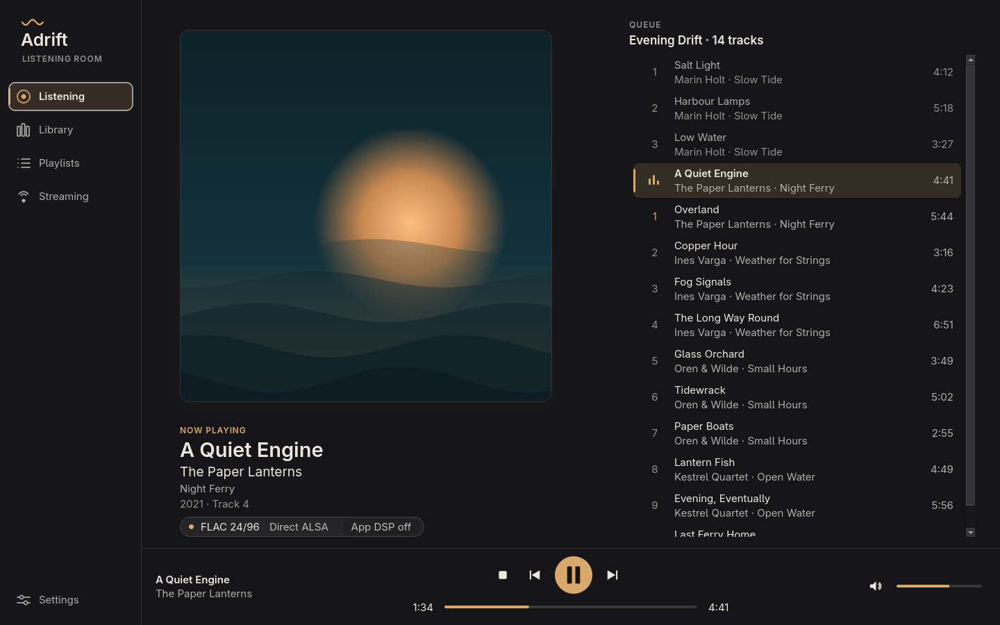

# Adrift

Adrift is a fork of [Strawberry Music Player](https://github.com/strawberrymusicplayer/strawberry) by LostandAdrift.
It is a native Qt 6 desktop player focused on a calm, readable listening experience and on being honest about what happens to your audio.

Adrift is free software under the GNU GPL v3 or later, the same license as Strawberry.
All credit for the player, the audio engine and the collection management goes to Jonas Kvinge and the Strawberry and Clementine contributors; see `COPYING` and the upstream repository.
Internal names (settings, binary, D-Bus, file formats) are unchanged so the fork stays compatible with upstream and can keep merging it.

## What is different

### The Listening Room (the main window)

Adrift opens on the **Listening Room**, even if you already used Strawberry on the same settings. Every destination is part of the same app: one rail, one transport bar, one look. The classic Strawberry window is not gone, but it is no longer a destination: it is an explicit **advanced** page (see Library).



*The image is a render of the real window widgets with synthetic data, not a photograph of a music collection.*

- **Side rail:** Listening, Library, Playlists, Streaming, and Settings. In narrow windows the rail shows icons only. `Alt+1` to `Alt+4` switch destinations. The rail is visible in every view, so the way back is always there.
- **Listening:** the current cover large, with a deliberate placeholder when there is no artwork or nothing is playing; title, artist, album; the signal path badge (click it for the details); and the **playlist** you are listening from: the real playlist, with stable playlist positions, the current track highlighted, compact rows, double click or Enter to play. The heading says where the list comes from ("Playing from" the playlist that plays, "Browsing" another one), not what plays next: explicit queueing, repeat and shuffle can change the next track, so the list order is never presented as a play order. It scrolls to whole rows with the current track near the top; if you scroll away it stays where you put it. The native Library provides Play next and Add to playlist; the full queue tools remain in Advanced tools.
- **Playlists:** your open playlists as cards (what is playing, which one is shown, Tidal/Qobuz snapshots). Choosing one shows *that* playlist's tracks. If another playlist is playing, the list is headed "Browsing" and says so, **playback is not touched**, and "Show what is playing" takes you back. Playing a row of the chosen playlist makes it the playing one.
- **Streaming:** one page, the same design as every other page: the account (Tidal and Qobuz where built in), your playlists with search, import and refresh, and every problem, all inline (see below). **Browse favorites** opens the service's catalog on this same page, inside the Adrift window, with a way back; it never opens the classic window. The page scrolls when a long state does not fit a small window. Nothing on it opens a separate window or settings dialog; the old settings page of a service is only reachable from "Advanced settings…" in the details of a problem.
- **Library:** a native page over the one collection Adrift already has (no second database). A header with search, **Albums** and **Artists** views, a grid of album covers, and an album page with its tracks. Search matches artist, album and track titles. Hovering an album lifts it and shows a play button; clicking opens the album; double clicking a track (or Enter) plays the album from that track, **Play next** and **Add to playlist** are explicit buttons and context-menu entries. Playing and adding use the current playlist, like the classic window does. The empty library says so and offers **Add music…** (a normal folder picker; the folder is added with the same collection workflow as the settings page, and the page says it is reading the folder until albums appear) and a way to connect a streaming service. The library is read on a worker thread when the page is first shown; results that arrive after something newer was asked are dropped.
  **Advanced tools…** (top right of the Library) opens the classic Strawberry window (collection tabs, tag editing, smart playlists, devices, files, radios) as a separate page with the rail still on the left. It is the only way in: the default Library, the account flow and the import flow never route into it.
- **Transport:** previous, play/pause, next, stop, seek with elapsed and length, and volume, always at the bottom of Listening, Playlists and Streaming. The buttons use the application's own actions, so they are enabled exactly when those are, and tray, shortcuts and MPRIS behave as before. The volume slider shows your setting and only ever changes it when you do; Adrift never sets the volume, the output device or exclusive mode for you.
- **Motion and whimsy:** restrained and musical, never a landing page. A single pill glides between the rail destinations; buttons, rail items and album tiles ease their hover and sink a little when pressed; the cover cross-fades to the next one; while a track plays a record slides out from behind the sleeve and turns slowly, and the wave in the wordmark drifts; the "reading your library" record turns while it waits. Every animation is short (120 to 340 ms) and repaints only the small widget that moves. Timers exist only while something is visibly moving: nothing runs when playback is stopped or paused, when the widget is hidden, or when motion is reduced.
  **Reduce motion** (rail, above Settings; keyboard and screen-reader accessible) switches all of it off at once: every animation jumps to its end state. The choice is remembered. The environment variable `ADRIFT_REDUCE_MOTION=1` starts Adrift with it on.
- **Resizing:** window resizing (a tiling window manager sends a stream of sizes) is cheap. Large artwork is reduced once to a master of at most 1280 px and the original is dropped; the sleeve (art, corners, shadow) is rendered once per size into one pixmap, stretched while the size is changing, and rendered sharp again when the size has been stable for about 130 ms. The responsive layout is only re-applied when it crosses a threshold, and the album grid recomputes its tile size once the width settles. Covers in the Library are requested at one size (a bucket), a few at a time, and cached.
- **Look:** it uses the current palette (Adrift Dark, the Omarchy colors, or the system colors) and follows runtime changes, scales with the font size, and every control has an accessible name and keyboard focus.
- **Remembering your page:** Adrift restores your chosen main page on the next start. The classic view is available only through Advanced tools and is never restored as the startup page.

The Adrift icon (`dist/unix/adrift.svg`) and a launcher entry (`dist/unix/adrift.desktop`) are provided; `-DINSTALL_ADRIFT_LAUNCHER=ON` installs them. The binary, the internal application name, the settings and the database are unchanged, so Adrift and Strawberry share one profile.

### Color themes (Settings → Appearance → Colors → Color theme)

- **Adrift Dark** (the default on a fresh install): neutral ink surfaces, warm off-white text and one restrained champagne-copper accent. Text and the accent are above 7:1 contrast against their backgrounds. It only sets palette colors; there is no global stylesheet, so controls keep their normal style.
- **System**: the Qt/desktop colors, unchanged. Installs that already saved an explicit color choice (system or a custom color set) keep it; only installs with no saved choice get Adrift Dark.
- **Omarchy colors (read when Adrift starts)**: uses the colors of the current Omarchy theme. Adrift reads `$XDG_STATE_HOME/omarchy/current/theme/colors.toml` (default `~/.local/state/omarchy/...`) and falls back to the older `~/.config/omarchy/current/theme/colors.toml`. The file is parsed as plain data with a small built-in parser; nothing from it is ever executed. It understands the flat `key = "#rrggbb"` layout (`background`, `foreground`, `accent`, `darker_background`, `lighter_background`, `color0`–`color15`, …).
  Text roles are corrected to at least 4.5:1 contrast (WCAG AA) against their backgrounds, so a low-contrast theme stays readable.
  A missing, unreadable, oversized, invalid or incomplete file is skipped; if no usable file is found the system colors are used.

The Omarchy theme is read when Adrift starts and when you change the setting. It does not live-update when you switch Omarchy themes: restart Adrift (or re-select it in Settings) to pick up the new theme.
A named theme overrides the custom color set; choose **System** to go back to it.
Previewing a theme and pressing Cancel restores the whole palette, including highlight and link colors.
Some Qt styles (for example Breeze) ignore palettes; use the Fusion style for full effect.

### Audio signal path badge and details

While a track plays, a small badge in the status row shows the source first, then the output, then a separate chip: for example `FLAC 16/44.1   System mixer   App DSP off`. Two things are kept apart on purpose:

- **App DSP** answers only "does Adrift itself change the samples?" It is on if the software volume is below 100% (or muted), or ReplayGain, loudness normalization, the equalizer, stereo balance, crossfeed, a forced channel count or fades are active. With volume control disabled the engine has no volume stage, so the volume level and mute do not count.
- **The output** is described separately: `Direct ALSA`, `ALSA plugin`, `System mixer` (PulseAudio/PipeWire), `Auto output`, or the sink name. A sound server mixes and may resample, so `App DSP off` never reads as an all-clear.

The badge never claims "bit-perfect". Adrift cannot see what a sound server, driver or DAC does after the samples leave the application. The strongest statement is `App DSP off` plus a note such as "Direct ALSA output. Not verified end to end."

The production GStreamer pipeline has a sample-preservation regression test: deterministic stereo PCM at 16, 24 and 32 bits, each at 44.1, 48 and 96 kHz, is captured at a silent output sink and compared byte for byte. With processing disabled, both bypassed volume and software volume at 100% preserve these samples, rates and formats. A 50% volume control case verifies that attenuation changes the samples. This verifies the application path for those cases, not ALSA negotiation, streamed decoding, the system mixer or a physical DAC.

The source comes from the track's own metadata (codec, bit depth, sample rate). Hi-Res is only claimed for lossless sources reporting more than 16 bit or more than 48 kHz; a lossy file with a "24 bit" tag is still lossy. Until a stream's metadata arrives the source stays `Source unknown` instead of being guessed.

When space is short the badge drops its secondary parts first: the `App DSP` chip, then the output label. The source (codec, bit depth, sample rate) is kept in full and only elided when even it does not fit; a long tag can never widen the window. The tooltip and the dialog always have the full picture.

The badge is a real button (keyboard focusable, Space/Enter to activate, accessible name and description). Click it to open the **Audio signal path** dialog: the source quality first, the output, then the processing. Only processing that is actually active is listed; everything that is off is one summary line. Technical text is collapsed under "Technical details" and **Copy details** copies it either way. The content scrolls, so the buttons stay reachable in a small window, and **Output settings…** opens the Backend settings.

### Streaming accounts and playlist import (inline page)

Signing in to **Tidal** or **Qobuz** and importing their playlists happens on one inline page (`StreamingImportView`, a plain `QWidget` that the main window hosts as a page). It is not a dialog and not a window: switching pages or applications behaves normally, nothing is raised over other windows, and nothing is modal.

- **Account header:** the service, whether you are signed in, not signed in, waiting for the browser, or need to set the sign-in up, with **Sign in / Reconnect / Cancel sign-in / Sign out**. A second service is one click away.
- **Sign-in inside Adrift:** Sign in opens the service's own sign-in page in your browser (the only browser handoff, as OAuth requires) and the page shows what to do, a Cancel button, and the address to copy if no browser could be started. When the browser returns, the page updates by itself and reads your playlists once. Every sign-in is a numbered attempt. A browser reply is only believed when it carries the state of the attempt that is waiting (wrong, empty, missing or repeated state is ignored, including a provider error without that state), the code exchange is tied to its attempt, and the page only accepts events of the attempt it started: a late callback of a cancelled or replaced attempt, a repeated callback while the code is being exchanged, or a background token refresh can neither finish nor fail a sign-in that is running. Cancelling during the exchange stores no session. Other OAuth users (Spotify and others) keep their visible failure and, when no browser can be started, their message box.
- **Setup honesty:** Tidal sign-in in Adrift is the one Strawberry's Tidal support has always used (legacy scopes `r_usr w_usr`, token endpoint `login.tidal.com/oauth2/token`, API `api.tidalhifi.com/v1`, redirect `tidal://login/auth`). Client IDs from Tidal's public developer dashboard use Tidal's newer sign-in (`login.tidal.com/authorize`, token endpoint `auth.tidal.com/v1`, PKCE; Tidal's SDK documentation) and the Strawberry maintainer states they are not compatible with this integration, so the page does NOT tell you to create a dashboard app. It says what this integration is, accepts a client ID that already works with Strawberry's Tidal support (kept exactly as saved), and says plainly that without one Tidal sign-in is not available yet. Playlists through Tidal's newer official API would be a separate sign-in that Adrift does not have. Qobuz needs the app ID, secret and private key of a Qobuz API application; Adrift ships none. Adrift does not fetch, guess, borrow or copy credentials, never restores a logged-out session, and does not change what is already saved.
- **Playlists:** cards with name, track count and whether the playlist is already a local snapshot, search, Refresh list, and Import (or **Refresh snapshot**). Progress and Cancel while reading. Remote order, repeated tracks, snapshot identity and "nothing is imported unless the complete list was read" are unchanged.
- **Problems stay visible** in a banner until they are resolved or dismissed. Each is classified (not signed in, sign-in expired, access denied, no connection, timeout, rate limited, service problem, unexpected reply) and offers what fits: **Reconnect** or **Sign in**, **Retry** (only repeats the read, rate limits wait for the requested time), **Dismiss**, and collapsible **Technical details**. A failed refresh keeps the last list on screen and says it may be out of date. A failed import never reads as a success: "Imported" appears only after the local playlist was created.
- **Signed out meanwhile:** the last list stays visible with a note; importing is disabled until you sign in again. Signing in with a different account discards the earlier list.

The remote identity (`tidal:<playlist id>`) is stored with the local playlist, so a refresh finds its snapshot after a restart. Importing again replaces the contents of that local snapshot. This is one-way synchronization: nothing is ever written to the service, and your own manually built playlists are never touched.

**Automatic refresh** is an optional per-service setting on the Streaming page, off by default. When enabled, it periodically reads the remote list and refreshes only playlists you already imported, one at a time. The opt-in belongs to the signed-in account; another account does not inherit it. Playing or paused snapshots are deferred, and the playing state is checked again before replacing a snapshot. Closed snapshot tabs are also deferred, so background refresh never opens tabs; open the snapshot to include it in automatic refresh. Errors remain visible and pause automatic refresh; provider rate limits delay requests. Cancel stops the current run, and disabling the setting stops future runs. This is not remote playlist editing or automatic import of every playlist in your profile.

Limits: this uses the services' playlist endpoints for the signed-in user (`users/{id}/playlists` and `playlists/{id}/items` for Tidal, `playlist/getUserPlaylists` and `playlist/get` for Qobuz). These are the private APIs the player already uses for these services; no official endorsement or stability is implied. Which playlists are listed: for Tidal, the playlists **you created**, not ones you only follow; for Qobuz, what `playlist/getUserPlaylists` returns for the account. This legacy integration requires an already compatible client; creating a public developer-dashboard app does not enable it. The `tidal://` callback must be associated with the Adrift launcher by the desktop (the launcher entry declares it); Adrift cannot verify that association. The old modal import dialog is gone.

### Direct ALSA setup (Settings → Backend, with an ALSA output)

The **Direct ALSA setup…** button opens a guided helper for sending audio straight to a hardware device with Adrift's own processing off.

- You must choose your device first. Only raw hardware (`hw:`) devices are offered, there is no default selection, and **Apply** stays disabled until you choose one.
- Applying changes the settings *page* only: output → ALSA, device → your `hw:` device, ReplayGain/loudness normalization/crossfeed/forced channels/fades → off. You still press OK or Apply in Settings to save. A summary lists exactly what will change.
- **It never changes your volume** and does not turn volume control off (which would play at full level). The dialog warns if the software volume is below 100% (which alters the samples), if the equalizer or stereo balance is on, and that a direct device can be much louder and is usually exclusive.
- The previous values are kept and **Restore previous settings** puts them back.

Direct ALSA also needs a hardware device that is not used by another program, and a file whose format the hardware supports.

## Building

Adrift builds exactly like Strawberry (C++17, Qt 6.4+, GStreamer). See `README.md` and `CLAUDE.md` for dependencies.

```
cmake -S . -B build
cmake --build build --parallel $(nproc)
```

Optional components can be disabled when their dependencies are missing, for example `-DENABLE_LAYERSHELLQT=OFF -DENABLE_TRANSLATIONS=OFF -DENABLE_STREAMTAGREADER=OFF`.

## Tests and renders

```
cmake --build build --target build_tests
cmake --build build --target test        # runs every test with CTest
```

New tests: `listeningroom_test` (navigation, empty and playing states, the playlist view over a real playlist, transport signals and enabled state, playlist browsing while another plays, 1000x700 fit, scrolling, the Library and the advanced page), `libraryview_test` (loading off the GUI thread, empty state, search by artist/album/track, album and artist browsing, playing and adding requests, cancellation when the view is destroyed or a newer request wins, cover cache bounds, the real collection backend through `CollectionLibrarySource`), `roommotion_test` (reduced motion, eased navigation and hover, cover fade and record, timers only while visibly moving, the resize cache, catalog and panel hosting), `adrift_resize_bench` (a measurement, not a pass/fail speed test: prints per-step timings for a large cover and a long queue; run it directly with `QT_QPA_PLATFORM=offscreen`), `adrift_surface_render_test` (full-surface renders of the real widgets, including the Library populated, empty, searched, an album, hovered, in all three palettes), `themepalette_test`, `signalpath_test`, `signalpathwidget_test`, `streamingimportview_test` (account session, failure classes, the inline page, OAuth callback handling, renders of every state), `playlistimport_test` (fake network, multi-page, expiry, cancel, refresh), `directalsa_test`, and `adrift_render_test`.

The Library renders use the production `LibraryView`, models and delegates with a synthetic `LibrarySource` (invented artists and albums, covers drawn by code); nothing reads a real library or profile.
`adrift_render_test` renders the real widgets, dialogs and palettes with synthetic data to PNG files without showing any window (it runs on Qt's offscreen platform). To keep the images, configure with `-DADRIFT_SCREENSHOT_DIR=<directory>`.

## Known limits

- The Omarchy theme is not live-updated (see above).
- Automated tests use fake provider responses. A separate read-only live check verified Qobuz playlist and track endpoints; the complete live UI import flow and Tidal sign-in remain unverified.
- Playlist synchronization refreshes existing imported snapshots only. It does not automatically import newly created remote playlists, delete local copies when remote playlists disappear, or edit remote playlists.
- Direct ALSA configuration is supported, but a successful physical-DAC bit-perfect verification is still outstanding. A mixed PipeWire route is not proof of bit-perfect output.
- Sample-rate/bit-depth of streamed tracks is only shown when the service reports it; otherwise the source shows as unknown.
- Branding is modest: the window and application display name is "Adrift". The internal application name, organization, settings and database paths, MPRIS identity, desktop file name and binary stay `strawberry`/`Strawberry`, so the fork stays compatible with an installed Strawberry and easy to merge with upstream. Upstream credits and license are unchanged. An Adrift icon and optional desktop launcher are included; distribution packages are not provided yet.
